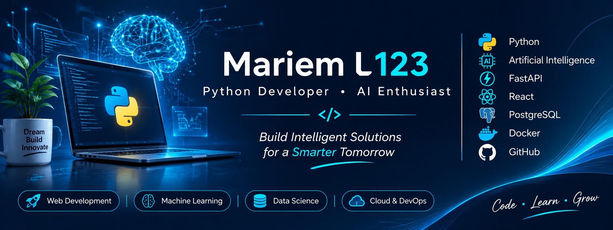

# Hi, I'm Mariem 👋

**Python Developer | AI & LLM Applications | Backend Development**

I'm a Python developer building practical software projects with Python, data tools, automation, and web technologies. I enjoy turning ideas into useful applications, improving code quality, and learning the engineering practices needed to deliver reliable software.

- 🔭 **Currently building:** Python applications, productivity tools, and automation projects.
- 🌱 **Currently learning:** LLM-powered applications, AI agents, APIs, backend architecture, and asynchronous task processing.
- 🧰 **Working with:** Python, Streamlit, SQLite, pandas, Plotly, scikit-learn, and web-scraping tools.
- 🎯 **Career interests:** Python development, AI application development, and backend engineering.
- 📍 **Based in:** Tunisia.

## Featured projects

### FocusBoard — Productivity & Analytics Dashboard

An interactive Streamlit dashboard for exploring task completion, workload by category, and productivity trends. The public demo uses synthetic sample data and can be tried without creating an account.

**Tech:** Python, Streamlit, pandas, Plotly.

[🚀 Open live demo](https://focusboard-w59vexfacjyptb5axohpki.streamlit.app/) · [View source code](https://github.com/mariemL123/Focusboard)

### Saveur & Aroma — Restaurant & Café Web Application

An interactive restaurant and café frontend featuring a multilingual menu, product customization, shopping cart, simulated checkout, and an administration dashboard for demonstrating restaurant management workflows.

**Tech:** React 19, TypeScript, Vite 8, Tailwind CSS 4, Lucide React, Motion, Vercel.

[🚀 Live Demo](https://saveur-arome-restaurant-caf-u94l.vercel.app/) · [💻 Source Code](https://github.com/mariemL123/Saveur-Arome-Restaurant-Caf-) · [📸 Screenshots](https://github.com/mariemL123/Saveur-Arome-Restaurant-Caf-#screenshots)

> **Demo limitations:** This is a frontend portfolio demonstration. Orders and products are held in client-side state and are not persisted in a production database. Checkout does not process real payments, and administrator authentication is client-side and not suitable for production use.

### AI Document Assistant — AI-Powered PDF Analysis

A deployed web application that extracts text from PDF documents, uses OCR for scanned pages, and generates structured analyses with the OpenAI API.

**Tech:** Python, FastAPI, PyMuPDF, Tesseract OCR, OpenAI API, SQLite, HTML, CSS, JavaScript, Chart.js, Docker.

[🚀 Live Demo](https://ai-document-assistant-79cp.onrender.com/app) · [📖 API Documentation](https://ai-document-assistant-79cp.onrender.com/docs) · [💻 Source Code](https://github.com/mariemL123/AI-Document-Assistant)

### OneDoc Dermatologists Scraper

A Python web-scraping project that collects and exports structured directory data for analysis.

**Tech:** Python, web scraping, pandas, Excel exports.

[View repository →](https://github.com/mariemL123/onedoc-dermatologists-scraper)

### GestClient 360 — CRM Concept

A documented concept for a customer relationship and claims-management platform. The repository currently contains project documentation; the application itself has not yet been implemented.

[View project concept →](https://github.com/mariemL123/GestClient-360---CRM-Gestion-des-R-clamations)

### Telegram Automation

A starting point for exploring Telegram automation. The repository is currently a documentation scaffold rather than a completed automation application.

[View repository →](https://github.com/mariemL123/Telegram_Automation.)

## Technical Skills

### Python & Backend

### AI & Data

### Frontend

### Databases & Tools

### Currently Learning

LLM Applications · RAG · AI Agents · Redis · Celery

*Technologies listed above reflect portfolio projects and ongoing learning.*

## What I'm working toward

- Building a complete Python API with automated tests and clear documentation.
- Developing an LLM-powered application with evaluation and responsible secret management.
- Improving project structure, dependency management, and automated quality checks.
- Publishing a polished portfolio with live demos where appropriate.

## Contact

- GitHub: [@mariemL123](https://github.com/mariemL123)

I'm happy to connect with developers and discuss Python, AI applications, and backend projects.
